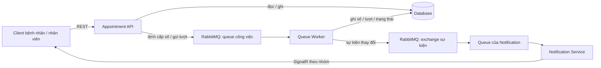

# Kế hoạch ClinicQueue — tuần 2 đến tuần 9

Ngày lập: 2026-11-10. **Đã chọn Web + PostgreSQL; phần mã/kiểm chứng/tài liệu tuần 2 đã hoàn thiện.** Đã rà soát toàn bộ giáo trình và xác nhận với người dùng: **chương N tương ứng tuần N**. Các quy tắc nghiệp vụ chi tiết còn cần chốt.

## Mục tiêu

Hoàn thành đề tài 09 với kiến thức và sản phẩm tích lũy từng tuần: REST → SignalR → xử lý cấp số qua RabbitMQ → sự kiện và thông báo → Docker → báo cáo/bảo vệ. Làm cá nhân trong học phần 9 tuần; hiện là tuần 2, còn 8 tuần tính cả tuần này.

## Bối cảnh và căn cứ

- Cập nhật cuối tuần2: hai project AppointmentApi/Client net10.0 chạy riêng; REST RAM/Web, detail/query và các bài tập đã hoàn thiện; build riêng0warning/error,14nhómPASS,31bản ghiHTTP. Xem docs/weekly/week-02.md và test-report.md. SDK10.0.403; PostgreSQL/Docker chưa dùng ở mốc này.
- Đã đọc toàn bộ hai giao đề, 10 PDF giáo trình (226 trang, gồm bản slide 36 trang) và 8 PDF thực hành (33 trang), gồm lý thuyết, listing, ghi chú, ôn tập và bài tập. [Báo cáo rà soát](reading-review.md), [sổ đọc từng trang](reading-notes.md), [danh mục nguồn](sources.md). Việc đọc không đồng nghĩa đã chạy mọi mã ví dụ.
- Người dùng xác nhận: kết hợp giáo trình và phần thực hành để phục vụ bài toán ClinicQueue. Bài thực hành từng tuần là căn cứ phải bám sát về thao tác/kỹ thuật/kiểm tra; G/T09 quyết định nghiệp vụ, kiến trúc và đầu ra sản phẩm.
- Người dùng xác nhận chương 1 = tuần 1, …, chương 9 = tuần 9; đang ở tuần 2. Chưa có ngày nộp/số giờ học cụ thể; không tự gán ngày lịch.

## Cách kết hợp tài liệu vào một bài toán xuyên suốt

**Giáo trình giải thích nguyên lý → bài thực hành hướng dẫn cách làm và kiểm tra → ClinicQueue là nơi vận dụng.** Mỗi tuần tương ứng đúng chương và bài thực hành cùng số. Khi hướng dẫn một bước, chỉ rõ mục/trang giáo trình, bước/trang thực hành, file hoặc hành vi ClinicQueue cần làm và kết quả cần quan sát.

- Bám các bước, cấu trúc, cơ chế giao tiếp, lỗi và minh chứng trong `Hướng dẫn thực hành trên lớp`; chuyển tài nguyên ví dụ sang bác sĩ, slot, lịch hẹn và hàng đợi khi áp dụng vào ClinicQueue. Nêu rõ phần đổi tên, đổi client hoặc điều chỉnh hợp đồng.
- Bài toán giữ đúng `Du án/HUONG-DAN-CHUNG.md` và đề tài 09: tám chức năng, sáu API tối thiểu, dữ liệu và luồng RabbitMQ/SignalR. Các mốc phân kỳ bên dưới là cách tổ chức thực hiện, không phải yêu cầu nguyên văn của giảng viên.
- Một minh chứng ClinicQueue có thể đồng thời chứng minh kiến thức và phần vận dụng nếu khớp mục tiêu đã đối chiếu. Không mặc định bắt tạo lại toàn bộ Catalog/EduSubmit trước khi được làm dự án.
- Bài nộp thực hành của lớp giữ yêu cầu riêng trong PDF. Chẳng hạn TH02 yêu cầu CatalogPractice + Console tự viết; bản Web ClinicQueue không tự được xem là thay thế bài nộp đó. Ghi rõ yêu cầu nộp nếu áp dụng, không trộn nó với nghiệm thu đề tài.
- GraphQL/gRPC vẫn được học và thực hành ở tuần 4/5. Dùng kết quả để đánh giá truy vấn, hợp đồng và ranh giới dịch vụ của ClinicQueue; tích hợp vào sản phẩm là lựa chọn riêng vì T09 không bắt buộc hai giao thức này. Bài mở rộng trong TH và G giữ nguyên nhãn mở rộng.

## Phạm vi và giới hạn

Đáp ứng [F01–F09, N01–N05, D01–D02](requirements.md): tra cứu, đặt/hủy, cấp số bất đồng bộ, gọi lượt, theo dõi trực tiếp, lưu trạng thái, chạy các service riêng và Docker, tài liệu/báo cáo/GitHub.

Tuần 4 học đầy đủ chương 4/TH04 (GraphQL), tuần 5 học đầy đủ chương 5/TH05 (gRPC), đúng lịch người dùng xác nhận. Đây là nội dung phải học/thực hành của môn; tích hợp GraphQL/gRPC vào sản phẩm đề tài 09 không phải yêu cầu gốc. Ghi nguồn thực hành cho từng phần áp dụng; tách yêu cầu bài nộp lớp khi PDF quy định sản phẩm riêng. Auth, DLQ nâng cao, thống kê và triển khai cloud để sau phần cốt lõi. Sử dụng dữ liệu mô phỏng.

## Lựa chọn kỹ thuật và trạng thái

| Vấn đề | Phương án / trạng thái | Lý do / đánh đổi |
|---|---|---|
| Lịch | Bám tuần 2–9, ôn bù tuần 1 trong đầu tuần 2 | Điều chỉnh theo hạn nộp thực tế nếu khác tuần 9 |
| Tên | Thư mục `ClinicQueue`, solution `ClinicQueue.slnx`; tên tiếng Việt trong báo cáo | Giữ mã đề tài 09 ở README, không cần đưa số vào namespace |
| Client | **Đã chọn Web** HTML/JavaScript; ASP.NET Core host tĩnh riêng | Giữ ranh giới HTTP của mẫu Console, cần xử lý CORS và lỗi HTTP phía browser |
| Database | **Đã chọn PostgreSQL**; dùng một DB cho bản học tập là phương án thiết kế | Xác minh kết nối và cấu hình riêng của dự án; không coi psql đã cài là server đã sẵn sàng |
| Cấu trúc | Một solution, 3 backend chạy độc lập + client + Contracts | Không cần thêm gateway hoặc tách database mỗi service ở giai đoạn này |

Người dùng đã chọn Web + PostgreSQL ngày 2026-11-10 và yêu cầu hướng dẫn từng bước. P01–P07 vẫn là quy tắc đề xuất cần chốt. C#/.NET 10, Minimal API, RabbitMQ, SignalR và Docker là yêu cầu gốc.

## Kiến trúc đề xuất



API tiếp nhận lịch, lưu trạng thái chờ và gửi yêu cầu; worker chịu trách nhiệm cấp số/thay đổi lượt. Worker phát sự kiện qua RabbitMQ; Notification Service nhận sự kiện và đẩy SignalR. Client truy vấn REST để lấy trạng thái gốc khi mở màn hình hoặc kết nối lại.

Trạng thái dự kiến: `PendingNumber → Queued → InService → Completed`; có nhánh `Cancelled` trước khi phục vụ. Cần chốt cách hủy và chuyển lượt trong tuần 2–4. DB là nguồn trạng thái có thẩm quyền; SignalR là thông báo thay đổi.

Một database dùng chung phù hợp phạm vi học tập (GT09 tr. 3). API và worker có thể cùng tác động lịch hẹn nên phải dùng transaction/điều kiện trạng thái; chỉ worker sinh số và chuyển lượt. Notification không tự thay đổi dữ liệu đặt lịch. Contracts dùng chung tên kênh và kiểu thông điệp, không chia sẻ toàn bộ entity DB.

## Cấu trúc dự kiến và thành phần ảnh hưởng

Hiện đã có solution, AppointmentApi và Client. Cây dưới đây là **đích cuối**, tạo dần theo chương; Contracts dùng cho hợp đồng message ở tuần 6, không cần tạo thư viện trống ở buổi đầu:

```text
ClinicQueue/
  ClinicQueue.slnx
  src/
    ClinicQueue.Contracts/               # class library, không phải service
    ClinicQueue.AppointmentApi/          # Minimal API + truy cập DB
    ClinicQueue.QueueWorker/             # BackgroundService, cấp số/gọi lượt
    ClinicQueue.NotificationService/     # subscriber + SignalR Hub
    ClinicQueue.Client/                  # Web HTML/JavaScript, host bằng ASP.NET Core
  tests/
    ClinicQueue.IntegrationTests/        # các kiểm tra hành vi cần thiết
  docs/
    sdlc/course-project/                 # kế hoạch, mục tiêu, yêu cầu, nguồn
    weekly/                             # kết quả và minh chứng theo tuần
    report/                             # báo cáo, sơ đồ, kịch bản bảo vệ
  docker-compose.yml
  .env.example                          # tên biến/mẫu cấu hình, không chứa bí mật
  .gitignore
  README.md
```

Mỗi project chạy như service .NET sẽ có Dockerfile riêng trong thư mục project; Contracts không có Dockerfile. Web client host bằng .NET đã chọn nên cũng có Dockerfile. Các bài Console/GraphQL/gRPC riêng của học phần không tự trở thành service triển khai của ClinicQueue. Dùng build context ở root để resolve project references. Tên `docker-compose.yml` bám giao đề dù một số bài thực hành dùng `compose.yaml`.

## Các bước thực hiện theo tuần

Tuần 1 chưa có minh chứng hoàn tất trong phiên này: đầu tuần 2 kiểm tra hoặc ôn MEP, solution/project/tiến trình, Minimal API và DI theo GT01/TH01. Nếu đã làm bài lớp thì dùng lại minh chứng. Yêu cầu nộp bài lớp thực hiện đúng PDF; phần hướng dẫn dự án tập trung áp dụng các kỹ thuật đó vào ClinicQueue.

| Tuần / chương | Học và thực hành học phần | Phần áp dụng vào ClinicQueue | Mốc kiểm chứng |
|---|---|---|---|
| **2 — hiện tại / GT02** | Kết hợp GT02 và TH02 bước 1–12,14: tài nguyên/URI, method, DTO, status, GET/POST, client và lỗi. TH02 bước 13 là mở rộng; ôn GT01/TH01 khi cần | Từ bộ khung API hiện có: GET bác sĩ/slot, POST lịch hẹn RAM, GET lịch theo ID và Web riêng. Lịch PendingNumber, chưa có số; chưa nối broker/DB | Bảng ca đối chiếu TH02 trên ClinicQueue: GET/POST/validation, 201+Location rồi GET lịch, 400/404, lỗi mạng và mất RAM khi restart. Chưa nghiệm thu lưu bền/cấp số |
| **3 / GT03** | Đọc toàn chương 3/TH03; Hub, Caller/All/Group, IHubContext, client, vòng đời kết nối | Tạo NotificationService + Hub và Web theo dõi bác sĩ/ngày bằng cập nhật thử có kiểm soát | Hai nhóm client nhận đúng; thử StartAsync thất bại lần đầu, reconnect/rejoin/đọc snapshot. Chưa gọi mô phỏng Task.Delay là luồng RabbitMQ hoàn chỉnh |
| **4 / GT04** | Học chương 4: schema, query/mutation; làm TH04 về query/chọn trường/lỗi và so sánh REST; nhận diện engine thật và ví dụ mô phỏng | Bắt đầu schema PostgreSQL và các thao tác lịch hẹn; đối chiếu nhu cầu chọn trường bác sĩ/lịch với bài GraphQL, giữ đủ thời gian thực hành TH04 | Bài TH04 có ba query A/B/C, chọn trường, query rỗng/sai và lỗi mất kết nối; giải thích parser chưa hỗ trợ mutation; schema và trạng thái ClinicQueue được chốt |
| **5 / GT05** | Học và làm TH05: proto, stub, unary RPC, deadline/cancellation, HTTP/2 và xử lý lỗi | Chuyển POST/GET lịch RAM sang PostgreSQL, bổ sung hủy, sức chứa/tranh chấp và 6 hợp đồng API; vận dụng bài gRPC để xác định contract/lỗi; thiết kế command/event tuần 6–7 | Bài gRPC chạy client/server riêng, đủ bốn phép tính, chia 0, deadline/cancellation và mất kết nối; ClinicQueue giữ dữ liệu qua restart, lịch chờ cấp số được ghi rõ chưa hoàn thiện F04/F05; không giả lập đã nhận số |
| **6 / GT06** | Học GT06 và làm TH06: producer–queue–worker, JSON/shared contracts, durable/persistent, ack/nack, delivery/recovery | Tạo Contracts/QueueWorker, tích hợp yêu cầu cấp số và gọi lượt qua RabbitMQ; chốt cách khôi phục DB–publish | Dừng worker trước/sau xử lý, quan sát Ready/Unacked, thử redelivery, JSON lỗi, NACK có/không requeue và broker mất kết nối. Không cấp số thứ hai cho cùng lịch; không kết luận exactly-once từ ack |
| **7 / GT07** | Đọc GT07/TH07: exchange/routing/binding, wildcard, event contract, subscriber và cầu nối SignalR | Phát sự kiện đổi số/lượt; NotificationService queue bền vững theo GT07 §7.3; nối Web với trạng thái thật | Demo xuyên suốt; tắt/bật notification; topology tồn tại trước publish; rejoin+snapshot; phân biệt command với event và luồng dữ liệu gốc |
| **8 / GT08** | Đọc GT08/TH08: đa tiến trình, config, logging, timeout/retry, Dockerfile/network, health/readiness và shutdown | Dockerfile từng service, docker-compose.yml, service name, lưu dữ liệu, runbook | Build code trước image; config/up/demo; bảng trước/trong/sau gián đoạn. Phân biệt depends_on ngắn, service_healthy và lỗi sau startup; kiểm tra readiness trong image thật |
| **9 / GT09** | Đọc GT09, chú giải kiến trúc, bảng MEP và các kịch bản thay đổi/đánh đổi | Nghiệm thu F/N/D; hoàn thiện báo cáo, GitHub/README; diễn tập bảo vệ | Sơ đồ ghi hướng/giao thức/đồng bộ–bất đồng bộ, ít nhất 3 điểm lỗi; bảng nguồn–đích/giao thức/MEP/lỗi/phục hồi, thuyết minh 300–500 từ vận dụng vào ClinicQueue; chạy lại bộ nộp |

Mỗi tuần có bảng truy vết **GT mục/trang → TH bước/trang → chức năng hoặc quyết định ClinicQueue → minh chứng**. Minh chứng được dùng chung khi thực sự đáp ứng cả hai mục tiêu; yêu cầu nộp bài mẫu của lớp vẫn được ghi riêng theo PDF. Không suy hoàn tất bài học từ một chức năng chạy được nếu các bước/ca còn thiếu.

Cuối mỗi tuần ghi kết quả thực tế trong `docs/weekly/week-XX.md`, cập nhật mục còn thiếu và tạo commit có nội dung rõ. Báo cáo được bổ sung dần từ sơ đồ và minh chứng mỗi tuần, không đợi đến tuần 9 mới bắt đầu viết.

## Cách hướng dẫn trong mỗi buổi

1. Nêu mục/trang GT và bước/trang TH đang áp dụng; giải thích khái niệm bằng chính tình huống ClinicQueue.
2. Giao một lát cắt nhỏ với file dự kiến, đầu vào/đầu ra và kết quả cần quan sát.
3. Người học thực hiện; đối chiếu mẫu sau khi thử, giải thích mã thay vì chép nguyên project.
4. Chạy kiểm chứng phù hợp, đọc log/lỗi và sửa từng vấn đề.
5. Tóm tắt điều đã hiểu, ghi minh chứng và commit; chọn bước tiếp theo trong cùng tuần.

[Hướng dẫn tuần 2](../../weekly/week-02.md) tiếp tục từ API Hello World người học đã tạo; bỏ qua các lệnh tạo lại. Kiểm tra khởi động là bước chuẩn bị. Sau đó đi theo các kỹ thuật TH02 trên API bác sĩ/lịch hẹn và Web, cùng bảng minh chứng có truy vết. Agent hướng dẫn/kiểm tra từng bước, không tự viết hết bài thay người học.

## Rủi ro và cách xử lý dự kiến

- **Lịch và DB đồng thời:** tránh kiểm tra chỗ trống rồi ghi độc lập; dùng transaction/ràng buộc phù hợp. Chốt chính sách cạnh tranh trước khi hoàn thiện F02/F03.
- **Lưu DB thành công nhưng publish lỗi:** cần bản ghi trạng thái gửi và cơ chế phát lại/đối soát hoặc outbox nhỏ. Chọn một phương án trong tuần 5; không coi chỉ đặt `Persistent=true` là giải quyết lỗi này.
- **Worker ghi DB rồi dừng trước ack/phát event:** chống cấp lại số và bảo đảm event cần gửi có thể được khôi phục. Thiết kế thứ tự commit/publish/ack và lưu dấu phát event trước tuần 6–7; không bỏ qua event chỉ vì số đã tồn tại.
- **Thông điệp độc hại/lỗi định dạng:** ghi nhận và xử lý có giới hạn; không requeue vô hạn. DLQ đầy đủ là tùy chọn mở rộng sau luồng chính.
- **Subscriber tạm dừng:** queue/binding cần tồn tại trước khi phát event; chọn durable=true, exclusive=false, autoDelete=false theo GT07 §7.3 tr. 19. Mẫu §7.2/TH07 dùng queue tạm để học sự khác biệt. Durable không lưu lại sự kiện đã phát trước khi queue/binding tồn tại; cần REST snapshot để khôi phục màn hình.
- **Client reconnect:** đăng ký lại nhóm rồi đọc snapshot; thống nhất phiên bản trạng thái/thứ tự cập nhật để snapshot cũ không ghi đè dữ liệu mới.
- **Docker chưa sẵn sàng:** khảo sát môi trường từ tuần 2, xử lý trước tuần 6 dùng broker. `depends_on` dạng ngắn không đợi readiness; dạng `condition: service_healthy` đợi healthcheck của dependency lúc khởi động (GT08 tr. 11, 16–17). Cả hai không thay cơ chế phục hồi khi dependency lỗi sau đó. Worker thuần không tự có HTTP /health; image chiseled có thể thiếu curl.
- **Web khác Console:** browser fetch đến API khác cổng cần policy CORS cho origin cụ thể; client kiểm tra response.ok/status trước khi đọc payload lỗi, có thể gặp body không phải JSON. POST JSON cần policy cho method/header; expose Location để Web đọc được và ghép đường dẫn tương đối với URL API. API xử lý DB, browser không kết nối PostgreSQL trực tiếp. Đây là phần chuyển đổi do lựa chọn Web, không phải yêu cầu nguyên văn của TH02.
- **Giới hạn mã minh họa:** GT06 §6.3 còn log/Processing, GT07 tr.18 chưa có transactional outbox; đọc mẫu để hiểu cơ chế, ghi rõ khoảng hở cần giải quyết cho bản lưu bền. Retry/DLQ/health/auth mở rộng theo G §3; không nâng toàn bộ cơ chế nâng cao thành tiêu chí chấm bắt buộc.
- **Giải thích CAP:** không suy ClinicQueue là AP chỉ vì trả 202. 202 mô tả tiếp nhận bất đồng bộ; phần thảo luận kiến trúc cần chỉ ra dữ liệu nào phải nhất quán, hành vi khi mất kết nối và đánh đổi cụ thể.
- **Khối lượng cá nhân:** giữ một worker và một notification instance ban đầu; ưu tiên F/N/D trước các phần mở rộng.

## Kế hoạch kiểm chứng

Mỗi F/N/D có phương pháp ở [requirements.md](requirements.md). Kiểm tra tự động tập trung vào rủi ro trạng thái, cạnh tranh, giao lại thông điệp và hợp đồng API. Demo nhiều client, kiểm tra broker, Compose và bảng thử lỗi bổ sung bằng chứng tích hợp thực tế.

Các lệnh `dotnet build`, `dotnet test`, `docker compose config`, `docker compose up --build` là kiểm chứng dự kiến theo giai đoạn. Hiện có một project bộ khung; trong đợt rà tài liệu này chỉ kiểm tra csproj/Program.cs và danh sách solution, chưa chạy build/test/Compose hoặc xác nhận chức năng nghiệp vụ.

## Khôi phục và quay lại mốc ổn định

Git ghi lại các mốc chạy được theo tuần. Nếu bước mới hỏng, tách thay đổi và quay về mốc gần nhất sau khi bảo toàn công việc đang làm; không xóa dữ liệu để che lỗi. Migration có bản sao dữ liệu demo trước khi đổi schema. Khi thử lỗi, chỉ dừng thành phần mục tiêu rồi khởi động lại; không xóa volume trong bài kiểm tra phục hồi.

Dự án đã chuyển sang ClinicQueue ở lượt trước và đối chiếu hash. Không tạo lại solution/project đã có. Khi sửa hướng dẫn, giữ nguyên mã người học; phần đọc giáo trình không tự cấp quyền làm tiếp toàn bộ ứng dụng.

## Câu hỏi còn mở và trạng thái

- Mỗi tuần dành được bao nhiêu giờ, hạn nộp theo ngày nào?
- Chốt ngày/phạm vi cấp số, sức chứa slot, điều kiện hủy và chính sách gọi lượt trong tuần 2–4.
- [x] Khảo sát hiện trạng và tài liệu; xác nhận cá nhân, tổng 9 tuần, hiện tuần 2.
- [x] Soạn kế hoạch, phạm vi, nguồn và nghiệm thu dự kiến.
- [x] Người dùng chọn Web + PostgreSQL; bắt đầu tuần 2 theo cách hướng dẫn từng bước.
- [x] Đọc đầy đủ bộ giáo trình/thực hành, bổ sung bảng truy vết và sổ đọc từng trang; chương N = tuần N đã được người dùng xác nhận.
- [ ] Tuần 2–9: thực hiện, kiểm chứng và cập nhật tiến độ theo thực tế.


## Mốc hoàn tất tuần2

Đã bàn giao mã REST/Web,31caHTTP thực tế,14nhóm kiểm chứng, lời giảiGT02/TH02 vàhướngdẫnchạy. Cókeywordmởrộng và4BTGT02chuyểnthể. Mốc tiếp theo làtuần3SignalR; không coi201/RAMlàđạt lưu bền/cấp số của đềcuối kỳ.
