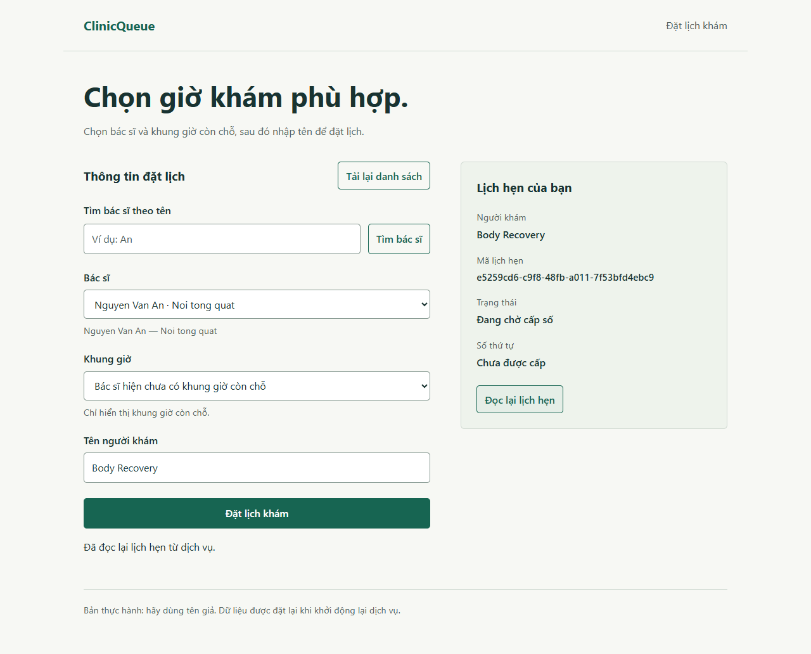
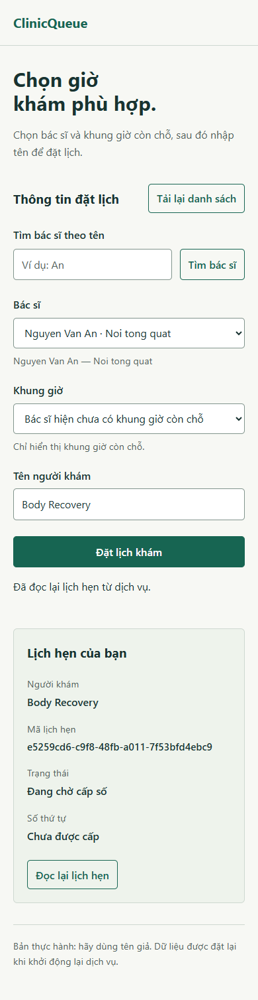

# Minh chứng HTTP tuần 2

Sinh từ verify-client.cjs; dữ liệu giả, yêu cầu HTTP thực tế.

Lần chạy: 2026-11-10T13:40:40.850Z

API test: http://localhost:15100; Web test: http://localhost:15200.

| Ca | Yêu cầu | Mong đợi / thực tế | Kết quả |
|---|---|---|---|
| 1 | GET / | 200 / 200 | PASS |
| 2 | GET /doctors | 200 / 200 | PASS |
| 3 | GET /doctors/1 | 200 / 200 | PASS |
| 4 | GET /doctors?keyword=%20nGuYeN%20 | 200 / 200 | PASS |
| 5 | GET /doctors?keyword=%20%20 | 200 / 200 | PASS |
| 6 | GET /doctors?keyword=zzzz | 200 / 200 | PASS |
| 7 | GET /doctors/999 | 404 / 404 | PASS |
| 8 | GET /doctors/abc | 404 / 404 | PASS |
| 9 | GET /doctors/1/slots | 200 / 200 | PASS |
| 10 | GET /doctors/3/slots | 200 / 200 | PASS |
| 11 | GET /doctors/999/slots | 404 / 404 | PASS |
| 12 | GET /doctors/abc/slots | 404 / 404 | PASS |
| 13 | POST /appointments | 201 / 201 | PASS |
| 14 | GET /appointments/ca00a49c-dde9-4e60-8091-59e8d7c5558e | 200 / 200 | PASS |
| 15 | GET /doctors/1/slots | 200 / 200 | PASS |
| 16 | GET /doctors/2/slots | 200 / 200 | PASS |
| 17 | POST /appointments | 400 / 400 | PASS |
| 18 | POST /appointments | 400 / 400 | PASS |
| 19 | POST /appointments | 400 / 400 | PASS |
| 20 | POST /appointments | 404 / 404 | PASS |
| 21 | POST /appointments | 404 / 404 | PASS |
| 22 | POST /appointments | 400 / 400 | PASS |
| 23 | POST /appointments | 409 / 409 | PASS |
| 24 | GET /doctors/1/slots | 200 / 200 | PASS |
| 25 | GET /doctors/2/slots | 200 / 200 | PASS |
| 26 | POST /appointments | 400 / 400 | PASS |
| 27 | GET /appointments/00000000-0000-0000-0000-000000000000 | 404 / 404 | PASS |
| 28 | GET /appointments/abc | 404 / 404 | PASS |
| 29 | GET /appointments/00bca172-f7c8-4df9-ba0d-ef0992370418 | 200 / 200 | PASS |
| 30 | GET /appointments/00bca172-f7c8-4df9-ba0d-ef0992370418 | 404 / 404 | PASS |
| 31 | GET /doctors/1/slots | 200 / 200 | PASS |

## Chi tiết request/response

### 1. GET gốc JSON service/status

```http
GET http://localhost:15100/
```

```http
HTTP 200

{
  "service": "ClinicQueue.AppointmentApi",
  "status": "running"
}
```

### 2. GET toàn bộ bác sĩ

```http
GET http://localhost:15100/doctors
```

```http
HTTP 200

[
  {
    "id": 1,
    "name": "Nguyen Van An",
    "specialty": "Noi tong quat"
  },
  {
    "id": 2,
    "name": "Tran Thi Binh",
    "specialty": "Nhi khoa"
  },
  {
    "id": 3,
    "name": "Le Minh Chau",
    "specialty": "Da lieu"
  },
  {
    "id": 4,
    "name": "Pham Minh Duc",
    "specialty": "Tai mui hong"
  }
]
```

### 3. GET chi tiết bác sĩ

```http
GET http://localhost:15100/doctors/1
```

```http
HTTP 200

{
  "id": 1,
  "name": "Nguyen Van An",
  "specialty": "Noi tong quat"
}
```

### 4. GET keyword không phân biệt hoa/thường

```http
GET http://localhost:15100/doctors?keyword=%20nGuYeN%20
```

```http
HTTP 200

[
  {
    "id": 1,
    "name": "Nguyen Van An",
    "specialty": "Noi tong quat"
  }
]
```

### 5. GET keyword rỗng giữ danh sách

```http
GET http://localhost:15100/doctors?keyword=%20%20
```

```http
HTTP 200

[
  {
    "id": 1,
    "name": "Nguyen Van An",
    "specialty": "Noi tong quat"
  },
  {
    "id": 2,
    "name": "Tran Thi Binh",
    "specialty": "Nhi khoa"
  },
  {
    "id": 3,
    "name": "Le Minh Chau",
    "specialty": "Da lieu"
  },
  {
    "id": 4,
    "name": "Pham Minh Duc",
    "specialty": "Tai mui hong"
  }
]
```

### 6. GET keyword không khớp

```http
GET http://localhost:15100/doctors?keyword=zzzz
```

```http
HTTP 200

[]
```

### 7. GET bác sĩ không tồn tại

```http
GET http://localhost:15100/doctors/999
```

```http
HTTP 404

{
  "code": "DOCTOR_NOT_FOUND",
  "message": "Khong tim thay bac si."
}
```

### 8. GET bác sĩ sai định dạng

```http
GET http://localhost:15100/doctors/abc
```

```http
HTTP 404

(body rỗng)
```

### 9. GET slot trước đặt lịch

```http
GET http://localhost:15100/doctors/1/slots
```

```http
HTTP 200

[
  {
    "id": 1,
    "doctorId": 1,
    "startTime": "2026-11-11T08:00:00+07:00",
    "endTime": "2026-11-11T08:30:00+07:00",
    "remainingSeats": 3
  }
]
```

### 10. GET bác sĩ có thật nhưng không có slot

```http
GET http://localhost:15100/doctors/3/slots
```

```http
HTTP 200

[]
```

### 11. GET slot bác sĩ không tồn tại

```http
GET http://localhost:15100/doctors/999/slots
```

```http
HTTP 404

{
  "code": "DOCTOR_NOT_FOUND",
  "message": "Khong tim thay bac si."
}
```

### 12. GET slot bác sĩ sai định dạng

```http
GET http://localhost:15100/doctors/abc/slots
```

```http
HTTP 404

(body rỗng)
```

### 13. Browser POST lịch hợp lệ

```http
POST http://localhost:15100/appointments
Content-Type: application/json

{
  "patientName": "Nguoi Hoc Demo",
  "doctorId": 1,
  "slotId": 1
}
```

```http
HTTP 201
Location: /appointments/ca00a49c-dde9-4e60-8091-59e8d7c5558e

{
  "id": "ca00a49c-dde9-4e60-8091-59e8d7c5558e",
  "patientName": "Nguoi Hoc Demo",
  "doctorId": 1,
  "slotId": 1,
  "status": "PendingNumber",
  "queueNumber": null
}
```

### 14. GET theo Location đúng DTO vừa tạo

```http
GET http://localhost:15100/appointments/ca00a49c-dde9-4e60-8091-59e8d7c5558e
```

```http
HTTP 200

{
  "id": "ca00a49c-dde9-4e60-8091-59e8d7c5558e",
  "patientName": "Nguoi Hoc Demo",
  "doctorId": 1,
  "slotId": 1,
  "status": "PendingNumber",
  "queueNumber": null
}
```

### 15. GET chỗ sau đặt, trước các POST lỗi

```http
GET http://localhost:15100/doctors/1/slots
```

```http
HTTP 200

[
  {
    "id": 1,
    "doctorId": 1,
    "startTime": "2026-11-11T08:00:00+07:00",
    "endTime": "2026-11-11T08:30:00+07:00",
    "remainingSeats": 2
  }
]
```

### 16. GET chỗ bác sĩ 2 trước lỗi

```http
GET http://localhost:15100/doctors/2/slots
```

```http
HTTP 200

[
  {
    "id": 3,
    "doctorId": 2,
    "startTime": "2026-11-11T09:00:00+07:00",
    "endTime": "2026-11-11T09:30:00+07:00",
    "remainingSeats": 2
  }
]
```

### 17. POST lỗi INVALID_APPOINTMENT {"patientName":" ","doctorId":1,"slotId":1}

```http
POST http://localhost:15100/appointments
Content-Type: application/json

{
  "patientName": " ",
  "doctorId": 1,
  "slotId": 1
}
```

```http
HTTP 400

{
  "code": "INVALID_APPOINTMENT",
  "message": "Ten benh nhan va cac ma bac si, khung gio phai hop le."
}
```

### 18. POST lỗi INVALID_APPOINTMENT {"patientName":"Demo","doctorId":0,"slotId":1}

```http
POST http://localhost:15100/appointments
Content-Type: application/json

{
  "patientName": "Demo",
  "doctorId": 0,
  "slotId": 1
}
```

```http
HTTP 400

{
  "code": "INVALID_APPOINTMENT",
  "message": "Ten benh nhan va cac ma bac si, khung gio phai hop le."
}
```

### 19. POST lỗi INVALID_APPOINTMENT {"patientName":"Demo","doctorId":1,"slotId":0}

```http
POST http://localhost:15100/appointments
Content-Type: application/json

{
  "patientName": "Demo",
  "doctorId": 1,
  "slotId": 0
}
```

```http
HTTP 400

{
  "code": "INVALID_APPOINTMENT",
  "message": "Ten benh nhan va cac ma bac si, khung gio phai hop le."
}
```

### 20. POST lỗi DOCTOR_NOT_FOUND {"patientName":"Demo","doctorId":999,"slotId":1}

```http
POST http://localhost:15100/appointments
Content-Type: application/json

{
  "patientName": "Demo",
  "doctorId": 999,
  "slotId": 1
}
```

```http
HTTP 404

{
  "code": "DOCTOR_NOT_FOUND",
  "message": "Khong tim thay bac si."
}
```

### 21. POST lỗi SLOT_NOT_FOUND {"patientName":"Demo","doctorId":1,"slotId":999}

```http
POST http://localhost:15100/appointments
Content-Type: application/json

{
  "patientName": "Demo",
  "doctorId": 1,
  "slotId": 999
}
```

```http
HTTP 404

{
  "code": "SLOT_NOT_FOUND",
  "message": "Khong tim thay khung gio."
}
```

### 22. POST lỗi SLOT_DOCTOR_MISMATCH {"patientName":"Demo","doctorId":2,"slotId":1}

```http
POST http://localhost:15100/appointments
Content-Type: application/json

{
  "patientName": "Demo",
  "doctorId": 2,
  "slotId": 1
}
```

```http
HTTP 400

{
  "code": "SLOT_DOCTOR_MISMATCH",
  "message": "Khung gio khong thuoc bac si da chon."
}
```

### 23. POST lỗi SLOT_FULL {"patientName":"Demo","doctorId":1,"slotId":2}

```http
POST http://localhost:15100/appointments
Content-Type: application/json

{
  "patientName": "Demo",
  "doctorId": 1,
  "slotId": 2
}
```

```http
HTTP 409

{
  "code": "SLOT_FULL",
  "message": "Khung gio da het cho."
}
```

### 24. GET chỗ bác sĩ1 sau lỗi

```http
GET http://localhost:15100/doctors/1/slots
```

```http
HTTP 200

[
  {
    "id": 1,
    "doctorId": 1,
    "startTime": "2026-11-11T08:00:00+07:00",
    "endTime": "2026-11-11T08:30:00+07:00",
    "remainingSeats": 2
  }
]
```

### 25. GET chỗ bác sĩ2 sau lỗi

```http
GET http://localhost:15100/doctors/2/slots
```

```http
HTTP 200

[
  {
    "id": 3,
    "doctorId": 2,
    "startTime": "2026-11-11T09:00:00+07:00",
    "endTime": "2026-11-11T09:30:00+07:00",
    "remainingSeats": 2
  }
]
```

### 26. POST JSON sai kiểu doctorId: binding chặn trước handler

```http
POST http://localhost:15100/appointments
Content-Type: application/json

{
  "patientName": "Demo",
  "doctorId": "abc",
  "slotId": 1
}
```

```http
HTTP 400

(body rỗng)
```

### 27. GET GUID đúng dạng nhưng lịch không có

```http
GET http://localhost:15100/appointments/00000000-0000-0000-0000-000000000000
```

```http
HTTP 404

{
  "code": "APPOINTMENT_NOT_FOUND",
  "message": "Khong tim thay lich hen."
}
```

### 28. GET ID lịch sai dạng: routing không vào handler

```http
GET http://localhost:15100/appointments/abc
```

```http
HTTP 404

(body rỗng)
```

### 29. GET lịch tồn tại ngay trước restart

```http
GET http://localhost:15100/appointments/00bca172-f7c8-4df9-ba0d-ef0992370418
```

```http
HTTP 200

{
  "id": "00bca172-f7c8-4df9-ba0d-ef0992370418",
  "patientName": "Nguoi Hoc Demo",
  "doctorId": 1,
  "slotId": 1,
  "status": "PendingNumber",
  "queueNumber": null
}
```

### 30. GET cùng ID sau restart: lịch RAM đã mất

```http
GET http://localhost:15100/appointments/00bca172-f7c8-4df9-ba0d-ef0992370418
```

```http
HTTP 404

{
  "code": "APPOINTMENT_NOT_FOUND",
  "message": "Khong tim thay lich hen."
}
```

### 31. GET slot sau restart: seed phục hồi

```http
GET http://localhost:15100/doctors/1/slots
```

```http
HTTP 200

[
  {
    "id": 1,
    "doctorId": 1,
    "startTime": "2026-11-11T08:00:00+07:00",
    "endTime": "2026-11-11T08:30:00+07:00",
    "remainingSeats": 3
  }
]
```

## Bài tập 2: dữ liệu mới, client không sửa

Trước: 3 bác sĩ; sau: 4 bác sĩ. Hai lượt chạy cùng hash Client: `b75534b163305267d70fb143916b00d7a88bf1c37752b225baa1f02b7b4c995d`.
Đối chiếu thời gian/hash trong http-cases.json. Các kiểm tra browser dùng số lượng dữ liệu trả về; không hardcode option bác sĩ trong app.js.

## Minh chứng client





Lịch RAM mất sau restart được chứng minh bằng cùng ID ở các ca cuối. Đây là kết quả agent chạy; không giả làm bài tự thực hiện của người học.