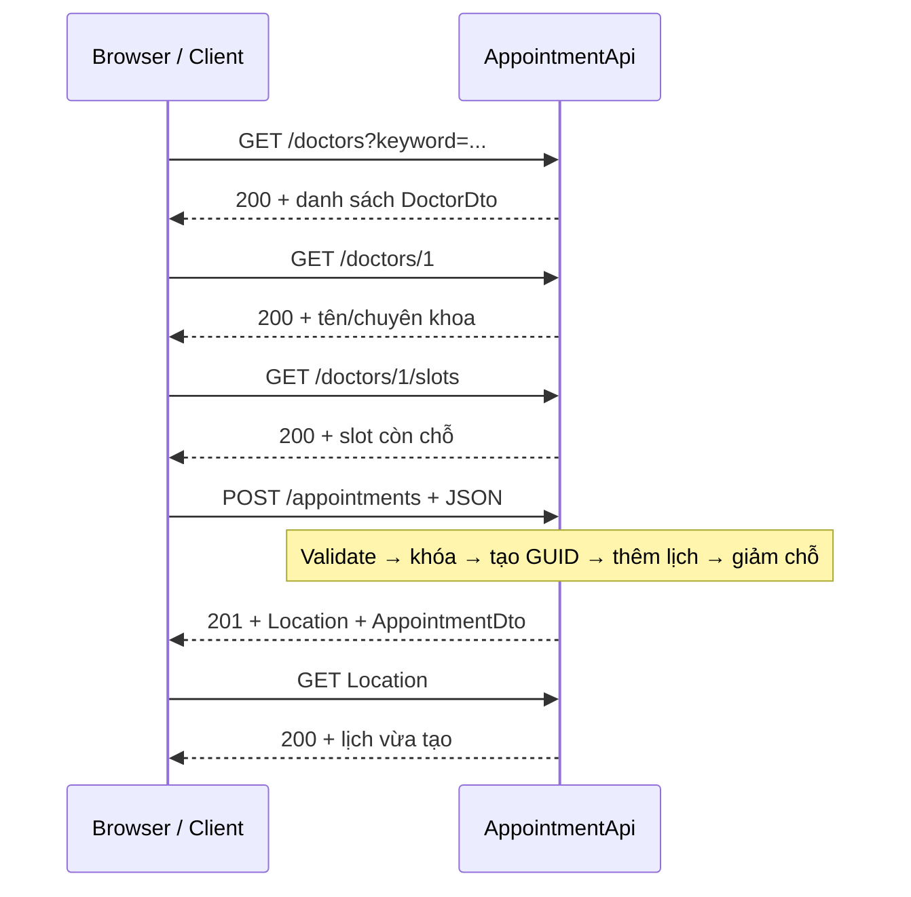

# Tuần 2 — REST và Web client trong ClinicQueue

**Đã hoàn thiện phần triển khai, kiểm chứng và tài liệu giải thích của tuần 2 trong ClinicQueue.** Kết quả cuối: build riêng 0 warning/error, 14 nhóm kiểm chứng tích hợp đạt, 31 bản ghi HTTP thực tế. Có cả phần mở rộng keyword. Đây là kết quả do agent triển khai/kiểm chứng theo yêu cầu; không khẳng định thay cho việc người học tự hiểu hoặc giảng viên chấp nhận bài nộp.

## Mở tài liệu theo thứ tự

1. [Giải thích mã API từng giai đoạn](../../Giai_thich/Tuan1_2.md).
2. [Tách client/server, CORS và fetch](../../Giai_thich/Tach_Client_Server_Tuan2.md).
3. [Ôn tập: 10 câu, 3 thảo luận, 4 bài tập và 4 câu TH02](../../Giai_thich/On_tap_Tuan2.md).
4. [Minh chứng 31 ca HTTP, ảnh và dữ liệu 3→4 bác sĩ](evidence/week-02/README.md).
5. [Bộ request thủ công](week-02.http) và [báo cáo kiểm chứng](../sdlc/course-project/test-report.md).

## Phạm vi đã hoàn thiện

- Hai project riêng: AppointmentApi giữ dữ liệu/kiểm tra/giữ chỗ; Client phục vụ HTML/CSS/JS. Browser gọi API qua HTTP.
- GET / trả JSON service/status.
- GET /doctors trả bốn bác sĩ; GET /doctors?keyword=... lọc tên, trim và không phân biệt hoa/thường. Thiếu hoặc rỗng keyword vẫn trả tất cả; không có kết quả trả 200 [].
- GET /doctors/{id:int} trả chi tiết; Web đọc và hiển thị tên/chuyên khoa trước khi đặt.
- GET /doctors/{id:int}/slots chỉ trả khung còn chỗ. Bác sĩ có thật nhưng không có khung trả 200 []; không có bác sĩ trả 404.
- POST /appointments kiểm đầu vào/quan hệ/sức chứa, sinh GUID, giữ một chỗ, trả 201 + Location + DTO lịch.
- GET /appointments/{id:guid} đọc lại lịch. Trạng thái PendingNumber, queueNumber=null.
- Web xử lý lỗi HTTP, lỗi mạng và phản hồi body lỗi; giữ Location khi đã biết POST201, không tự POST lại.
- Kiểm API tắt/bật và mất dữ liệu RAM khi restart; bảng minh chứng và bài giải đã có.

GET chi tiết bác sĩ là endpoint bổ sung để chuyển thể GT02 bài tập3; đề T09 quy định tập API tối thiểu, không bắt đổi POST /appointments thành route lồng. Keyword là mở rộng TH02 bước13, không phải điều kiện bắt buộc của bản cơ bản.

## Đối chiếu toàn bộ TH02

Nguồn: [TH02 — Catalog REST API](<D:/CODE/Giao_Trinh/Hệ thống phân tán/Hướng dẫn thực hành trên lớp/Thuc_hanh_2_2_Catalog_REST_API.pdf>).

| Bước / trang | Áp dụng và kết quả trong ClinicQueue |
|---|---|
| 1 / 1 | Solution .NET10 có API và Web client độc lập; build đạt |
| 2 / 1 | DoctorDto, SlotDto, CreateAppointmentRequest, AppointmentDto, ApiError; dữ liệu mẫu RAM |
| 3 / 2 | GET gốc JSON và GET danh sách bác sĩ |
| 4 / 2 | GET chi tiết/slot/lịch; route constraint, 200 và 404 |
| 5 / 2 | POST JSON, validation, ID do server sinh, Trim tên, 201 + Location |
| 6 / 2–3 | Browser thực hiện đọc → tạo → đọc lại → xử lý yêu cầu sai |
| 7 / 3 | Lệnh build, hai lệnh chạy, URL và kết quả ghi trong báo cáo |
| 8 / 3 | GET hợp lệ, không có dữ liệu, ID không tồn tại; có request/response thực |
| 9 / 3 | POST201 có Location, GET cùng URI trả DTO bằng DTO POST |
| 10 / 3–4 | 400/404/409, binding/routing; code/message và body rỗng được phân biệt |
| 11 / 4 | Browser chạy từ Web riêng; không ProjectReference sang API |
| 12 / 4 | Cùng ID trước restart200, sau restart404; số chỗ khôi phục về seed3 |
| 13 / 4–5 | Đã làm mở rộng keyword; có bản sao API trước sửa trong artifacts/week-02-before |
| 14 / 5 | 31 ca có dữ liệu thực, ảnh Web, 201/Location/restart và bốn câu trả lời trong tài liệu ôn tập |

TH02 gốc yêu cầu CatalogPractice/Console tự viết nếu nộp riêng bài thực hành. Bộ này là phần chuyển thể vào ClinicQueue theo lựa chọn Web của người học; không tự tạo thêm Catalog và không khẳng định thay bài nộp gốc.

## Bốn bài tập GT02 trang 21

Nguồn: [GT02](<D:/CODE/Giao_Trinh/Hệ thống phân tán/Giáo trình pdf/chapter02.pdf>).

| Bài | Chuyển thể và bằng chứng |
|---|---|
| 1 | Build, chạy API/Web, đọc danh sách bác sĩ, nhận ID lịch và thử lỗi400 |
| 2 | Ban đầu3bác sĩ; chỉ thêm bác sĩ4 vào seed API, chạy lại. Hash tổng hợp Program.cs/HTML/CSS/JS Client trước/sau giống nhau. Xem newFixtureProof trong http-cases.json |
| 3 | Chọn bác sĩ gọi GET /doctors/{id}; hiển thị tên/chuyên khoa trước POST. Test browser xác nhận vùng chi tiết đã có trước click đặt |
| 4 | Test chọn ID999 từ client: nhận DOCTOR_NOT_FOUND/404, hiển thị lỗi và không tiếp tục luồng đặt |

## Chạy và quan sát

Nếu hai ứng dụng đang chạy phiên cũ, nhấn Ctrl+C ở hai terminal đó rồi chạy lại để nạp mã mới. Thực hiện tại D:\CODE\TREN_LOP\He_Thong_Phan_Tan\ClinicQueue.

```powershell
dotnet build ClinicQueue.slnx
```

Terminal API:

```powershell
dotnet run --project src/ClinicQueue.AppointmentApi --launch-profile http
```

Terminal Web:

```powershell
dotnet run --project src/ClinicQueue.Client --launch-profile http
```

Mở http://localhost:5200. Cổng API là5100. Trong DevTools > Network, quan sát:

1. Trang lấy /client-config từ5200 và /doctors từ5100; có4bác sĩ.
2. Tìm Nguyen; thấy bác sĩ Nguyen Van An. Xóa lọc bằng Tải lại danh sách.
3. Chọn bác sĩ1: GET chi tiết và GET slot; có slot1 còn3chỗ lúc mới khởi động.
4. Nhập tên giả, đặt lịch: POST201, Location, GET lại cùng lịch; slot còn2.
5. Chọn lại slot rồi nhập tên chỉ có khoảng trắng: API400; client hiển thị code/message.
6. Lưu ID lịch; dừng/khởi động lại API. GET cùng ID trả404, slot về3. Đây là RAM, chưa phải PostgreSQL.

Tập .http cho thêm ca404/409 và ID sai dạng. Giữ cùng phiên API khi so sánh số chỗ trước/sau lỗi; không xen POST hợp lệ hoặc restart vào phép so sánh.

## Giải thích luồng chính



GET lấy biểu diễn tài nguyên. Path xác định tài nguyên; query lọc danh sách. POST tạo lịch mới nên dùng201; Location cho client biết URI đọc lại. DTO đầu vào chỉ gồm dữ liệu client được gửi; ID, trạng thái và số do server quản lý. Stateless không cấm server lưu dữ liệu nghiệp vụ: mỗi request phải đủ thông tin để xử lý, không phụ thuộc trạng thái hội thoại client. GET là safe/idempotent theo ý nghĩa giao thức; POST tạo lịch hiện tại không idempotent, gửi lại có thể tạo lịch khác.

Route {id:int}/{id:guid} không khớp trả404 trước handler; JSON sai kiểu có thể bị binding trả400 trước handler. ApiError chỉ bảo đảm ở các nhánh nghiệp vụ của mình, không phải mọi lỗi framework. Bác sĩ có thật mà hết slot trả200[] vì truy vấn hợp lệ; bác sĩ không có trả404; slot có thật nhưng hết chỗ khi POST trả409.

Các khái niệm ở GT02 trang1–7; DTO/binding/validation/status ở trang10–11; client ở trang12–13 và18–19; câu hỏi/bài tập ở20–21. Lời giải đầy đủ nằm trong tài liệu ôn tập.

## Giới hạn của mốc tuần2

Dữ liệu RAM, lock chỉ có hiệu lực trong một tiến trình. 201 xác nhận tạo lịch, chưa cấp số; PendingNumber/null thể hiện đúng điều đó. PostgreSQL tuần4–5, RabbitMQ/worker tuần6, event tuần7 theo [kế hoạch](../sdlc/course-project/plan.md). PUT/PATCH/DELETE được giải thích như kiến thức REST, không tự thêm chức năng hủy lịch/cấp số trước mốc đã thống nhất.

Phần mã, kiểm chứng và bài giải tuần2 đã bàn giao. Người học có thể dùng tài liệu để chạy lại, tự giải thích và chuẩn bị nộp/bảo vệ; việc đó không được giả định đã thực hiện chỉ vì agent đã chạy test.
