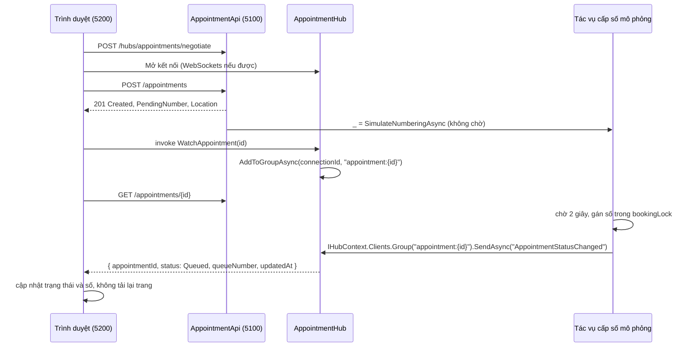

# Tuần 3 — SignalR: đẩy số thứ tự về trình duyệt

Tuần 3 bổ sung kênh thời gian thực cho ClinicQueue theo GT03 §3.3 (mẫu EduSubmit). REST vẫn tạo và đọc lịch hẹn. SignalR chỉ báo cho trình duyệt khi trạng thái lịch hẹn thay đổi, nên người khám không phải bấm "Đọc lại" để biết mình đã có số.

## Mở tài liệu theo thứ tự

1. GT03 §3.1 (trang 1–3): ba mô hình trao đổi thông điệp, WebSocket và SignalR, khi nào cần thời gian thực.
2. GT03 §3.2 (trang 4–9): kỹ thuật cơ bản qua PingApi/PingClient: `AddSignalR`, `MapHub`, Hub, `Clients.Caller/All/Group`, `HubConnection`, vòng đời kết nối.
3. GT03 §3.3 (trang 9–18): EduSubmit kết hợp REST và SignalR. Đây là khuôn mẫu trực tiếp cho tuần này.
4. TH03 (Thuc_hanh_3_2_SignalR.pdf): bài nộp lớp PingApi/PingClient, làm riêng, không thay bằng ClinicQueue.
5. Microsoft Learn, *Security considerations in ASP.NET Core SignalR* (mục CORS) và *ASP.NET Core SignalR JavaScript client*: phần trình duyệt mà giáo trình không có.

## Đối chiếu GT03 → ClinicQueue

| Giáo trình (EduSubmit) | ClinicQueue | Vị trí mã |
|---|---|---|
| `builder.Services.AddSignalR()` | Giữ nguyên | [Program.cs:22](../../src/ClinicQueue.AppointmentApi/Program.cs:22) |
| `app.MapHub<SubmissionHub>("/hubs/submissions")` | `app.MapHub<AppointmentHub>("/hubs/appointments")`, đặt sau `UseCors` | [Program.cs:209](../../src/ClinicQueue.AppointmentApi/Program.cs:209) |
| `SubmissionHub.WatchSubmission(string)` chỉ cho client vào nhóm | `AppointmentHub.WatchAppointment(Guid)`, không chứa nghiệp vụ | [Program.cs:295](../../src/ClinicQueue.AppointmentApi/Program.cs:295) |
| Nhóm `submission:{id}` qua `SubmissionGroups` | Nhóm `appointment:{id}` qua `AppointmentGroups` | [Program.cs:324](../../src/ClinicQueue.AppointmentApi/Program.cs:324) |
| POST trả 201 rồi `_ = SimulateGradingAsync(...)` | POST trả 201 `PendingNumber` rồi `_ = SimulateNumberingAsync(...)` | [Program.cs:186](../../src/ClinicQueue.AppointmentApi/Program.cs:186) |
| `UpdateStatusAsync` cập nhật danh sách và gửi qua `IHubContext` | `AssignSimulatedQueueNumber` (gán số trong khóa) + `NotifyStatusChangedAsync` (gửi tới đúng nhóm) | [Program.cs:248](../../src/ClinicQueue.AppointmentApi/Program.cs:248), [Program.cs:281](../../src/ClinicQueue.AppointmentApi/Program.cs:281) |
| Sự kiện `SubmissionStatusChanged`, bản tin `SubmissionStatusMessage` | Sự kiện `AppointmentStatusChanged`, bản tin `AppointmentStatusMessage(AppointmentId, Status, QueueNumber, UpdatedAt)` | [Program.cs:330](../../src/ClinicQueue.AppointmentApi/Program.cs:330), [Program.cs:357](../../src/ClinicQueue.AppointmentApi/Program.cs:357) |
| `SubmissionDto` có `ReceivedAt`, `UpdatedAt` | `AppointmentDto` thêm `CreatedAt`, `UpdatedAt` | [Program.cs:346](../../src/ClinicQueue.AppointmentApi/Program.cs:346) |
| `OnConnectedAsync`/`OnDisconnectedAsync` (PingHub) | Ghi nhật ký kết nối, ngắt kết nối, theo dõi lịch | [Program.cs:295](../../src/ClinicQueue.AppointmentApi/Program.cs:295) |
| `HubConnectionBuilder().WithUrl().WithAutomaticReconnect()` | Bản JavaScript, URL tuyệt đối tới API | [app.js:221](../../src/ClinicQueue.Client/wwwroot/app.js:221) |
| `connection.On<T>("SubmissionStatusChanged", ...)` | `connection.on("AppointmentStatusChanged", applyStatusMessage)` | [app.js:228](../../src/ClinicQueue.Client/wwwroot/app.js:228) |
| Client POST xong mới gọi `WatchSubmission`, cuối cùng GET lại | POST → `WatchAppointment` → GET lại | [app.js:319](../../src/ClinicQueue.Client/wwwroot/app.js:319) |
| `Reconnecting`/`Closed`; sau khi kết nối lại nên gọi REST (§3.2.5) | `onreconnecting`, `onreconnected` (vào lại nhóm + GET), `onclose` (hẹn thử lại) | [app.js:229](../../src/ClinicQueue.Client/wwwroot/app.js:229), [app.js:204](../../src/ClinicQueue.Client/wwwroot/app.js:204) |

## Khác giáo trình và vì sao

1. **Client là trình duyệt, không phải console.** Giáo trình dùng gói NuGet `Microsoft.AspNetCore.SignalR.Client`. Trình duyệt cần thư viện JavaScript `@microsoft/signalr`. Bản 10.0.11 (cùng đời với .NET 10) được đặt sẵn ở `wwwroot/lib/signalr/signalr.min.js` để chạy được khi không có mạng lúc bảo vệ. Nguồn và giấy phép MIT ghi trong `wwwroot/lib/signalr/LICENSE.txt`.
2. **CORS phải mở thêm.** Web ở cổng 5200 gọi hub ở cổng 5100 là gọi khác origin. Theo tài liệu SignalR security của Microsoft:
   - `AllowCredentials()` là bắt buộc, vì client JavaScript mặc định gửi kèm credentials.
   - Cho phép `X-Requested-With` và `X-SignalR-User-Agent`, hai header mà bước negotiate gửi đi.
   - Cho phép `DELETE`, vì kiểu truyền Long Polling dùng nó để dọn kết nối.
   - `UseCors` phải đứng trước `MapHub`.

   Origin vẫn chỉ là danh sách trong cấu hình, không dùng `*`.
3. **`WatchAppointment(Guid)` thay vì `string`.** Mã sai định dạng bị từ chối ngay. Mã viết hoa hay viết thường đều được chuẩn hóa nên vào đúng nhóm mà phía gửi dùng. Ca T8 trong kiểm thử theo dõi bằng mã viết hoa vẫn nhận đúng.
4. **Chỉ một bước chuyển `PendingNumber → Queued`.** EduSubmit có hai bước (processing, graded). ClinicQueue chỉ có bước cấp số. `InService`/`Completed` thuộc chức năng gọi lượt (F06), chưa làm ở tuần này.
5. **Thời gian trễ đặt trong cấu hình** `Numbering:SimulatedDelaySeconds` (mặc định 2), theo yêu cầu tách cấu hình khỏi mã của hướng dẫn chung.
6. **Bắt lỗi trong tác vụ nền.** Lệnh `_ = ...` không ai chờ kết quả, nên nếu không có `try/catch` thì lỗi sẽ mất mà không ai thấy. Lỗi được ghi vào log.
7. **Xử lý thứ tự giữa hai đường.** GET và bản tin SignalR đi trên hai kết nối khác nhau, có thể về không theo thứ tự.
   - Client vào nhóm trước rồi mới GET: thay đổi xảy ra trước lúc vào nhóm sẽ thấy qua GET, thay đổi sau đó sẽ được đẩy về.
   - Client so `updatedAt` để không ghi đè bản mới bằng bản cũ đến muộn.
   - Bản tin đến khi GET chưa hiển thị xong thì được giữ lại rồi áp dụng sau.
8. **Lần kết nối đầu thất bại thì tự thử lại sau mỗi 5 giây.** `withAutomaticReconnect` chỉ lo các lần kết nối lại sau khi đã kết nối thành công, không lo lần `start()` đầu tiên (TH03 bước 10.3).

## Luồng chính



Hub không biết gì về đặt lịch. Phía gửi là tác vụ nền, dùng `IHubContext` vì nó nằm ngoài lớp hub. Tuần 5 thay phần gán số bằng NumberingService (gRPC). Tuần 6 chuyển sang QueueWorker qua RabbitMQ. Tuần 7 chuyển hub sang NotificationService. Cách trình duyệt nhận tin không đổi qua các tuần đó.

## Chạy và quan sát

Tại thư mục ClinicQueue:

```powershell
dotnet build ClinicQueue.slnx
```

Terminal API:

```powershell
dotnet run --project src/ClinicQueue.AppointmentApi --launch-profile http
```

Terminal Web:

```powershell
dotnet run --project src/ClinicQueue.Client --launch-profile http
```

Mở http://localhost:5200 rồi thử:

1. **DevTools > Network:** có request `negotiate?negotiateVersion=1` (POST 200) và một kết nối WebSocket tới `/hubs/appointments`. Tab Messages của WebSocket hiện bản tin đẩy về.
2. **Đặt lịch:** phiếu hiện "Đang chờ cấp số". Khoảng 2 giây sau, số thứ tự tự hiện, chữ chuyển màu xanh, và có dòng "Đang tự cập nhật trạng thái lịch hẹn này".
3. **Terminal API** in các dòng `Ket noi SignalR moi …`, `Ket noi … theo doi lich …`, `Cap so mo phong: lich … -> Queued, so N`.
4. **Hai tab, mỗi tab một lịch:** mỗi tab chỉ nhận số của lịch hẹn của nó. Số tăng riêng theo từng bác sĩ.
5. **Ngắt kết nối:** Ctrl+C terminal API, trang báo "Mất kết nối cập nhật tự động, đang thử kết nối lại…". Chạy lại API trong vòng khoảng 30 giây (mốc thử lại 0, 2, 10, 30 giây): trang tự kết nối lại, vào lại nhóm và GET lại. Vì dữ liệu nằm trong RAM, GET trả 404 và trang báo lịch không còn. Đây là lý do tuần 4–5 chuyển sang PostgreSQL.
6. **Mở trang khi API đang tắt:** trang báo sẽ thử lại sau 5 giây. Bật API là trang tự kết nối, không cần tải lại.

Request mẫu: [week-03.http](week-03.http). Request này cho thấy negotiate trả 3 kiểu truyền, GET thẳng URL hub trả 400 "Connection ID required", và lịch hẹn chuyển sang `Queued` sau khoảng 2 giây.

## Kiểm thử đã chạy (2026-11-21, cổng thử 15100/15200, dữ liệu giả)

| Nhóm | Kết quả | Minh chứng |
|---|---|---|
| Tích hợp SignalR bằng Node (`@microsoft/signalr` 10.0.11), 12 ca: negotiate, CORS đúng/sai origin, 3 kiểu truyền, nhóm tách biệt, mã viết hoa, client không theo dõi thì không nhận, GET sau thông báo, số tăng theo bác sĩ, mã sai bị từ chối | 12/12 PASS | [evidence/week-03](evidence/week-03/README.md) |
| Trình duyệt thật (pane trình duyệt của Claude desktop): kết nối khác origin, đặt lịch tự hiện số, tab thứ hai không làm đổi tab thứ nhất, tắt/bật API thì kết nối lại và báo 404 do RAM, mở trang khi API tắt rồi tự kết nối | 5/5 đạt | Mô tả trong evidence/week-03 |
| Hồi quy tuần 2 (`scripts/verify-client.cjs`, Playwright, chạy với `Numbering__SimulatedDelaySeconds=3600` để giữ `PendingNumber`) | 15/15 PASS | Chạy lại theo test-report |
| `dotnet build ClinicQueue.slnx` | 0 cảnh báo, 0 lỗi | |

## Giới hạn của mốc tuần 3

- Cấp số là mô phỏng bằng `Task.Delay`, dữ liệu nằm trong RAM. Nếu API dừng giữa lúc chờ, lịch hẹn kẹt ở `PendingNumber` (chưa có hàng đợi bền; tuần 6 giải quyết bằng RabbitMQ và ack).
- Số thứ tự tăng theo bác sĩ, chưa tách theo ngày, vì mọi slot mẫu cùng một ngày. Quy tắc P01–P07 vẫn chờ chốt.
- SignalR không phát lại tin bị lỡ. Client luôn dựa vào GET để lấy trạng thái gốc.
- Nhóm lưu trong bộ nhớ của một tiến trình API. Muốn chạy nhiều bản API cần backplane (GT03, câu thảo luận 3).
- Một kết nối có thể ở nhiều nhóm vì chưa có thao tác rời nhóm. Client bỏ qua tin không thuộc lịch đang xem.
- Ai biết mã lịch hẹn thì theo dõi được, cùng mức truy cập với GET bằng mã. Chưa có xác thực.
- Hub đặt tạm trong AppointmentApi. Tuần 7 chuyển sang NotificationService.
- Chưa làm gọi lượt (`InService`/`Completed`), `DELETE /appointments/{id}`, `GET /queues/{doctorId}`.

## Việc của người học

- Đọc phần giải thích từng phần và trả lời câu hỏi ôn tập GT03 (có lời giải tham khảo trong `Giai_thich/On_tap_Tuan3.md`, thư mục chỉ có trên máy).
- TH03 nộp lớp (PingSignalR) làm riêng: tự viết mã, chạy 2 client, lập bảng Caller/All/Group, ngắt/nối lại.
